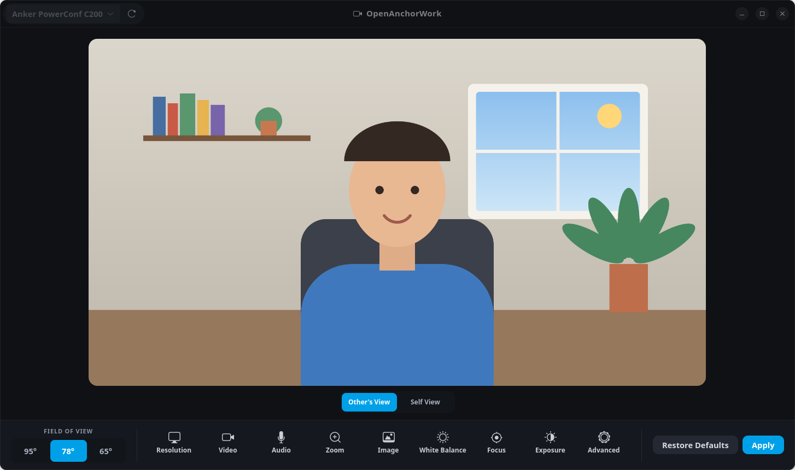
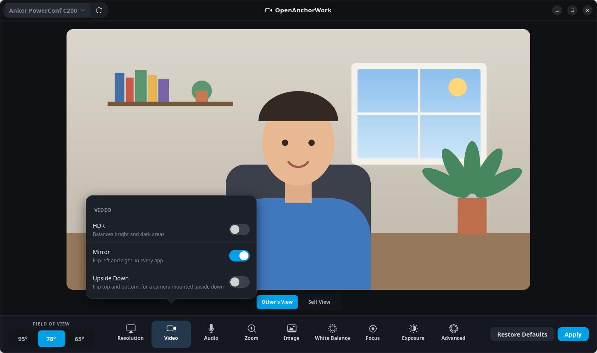
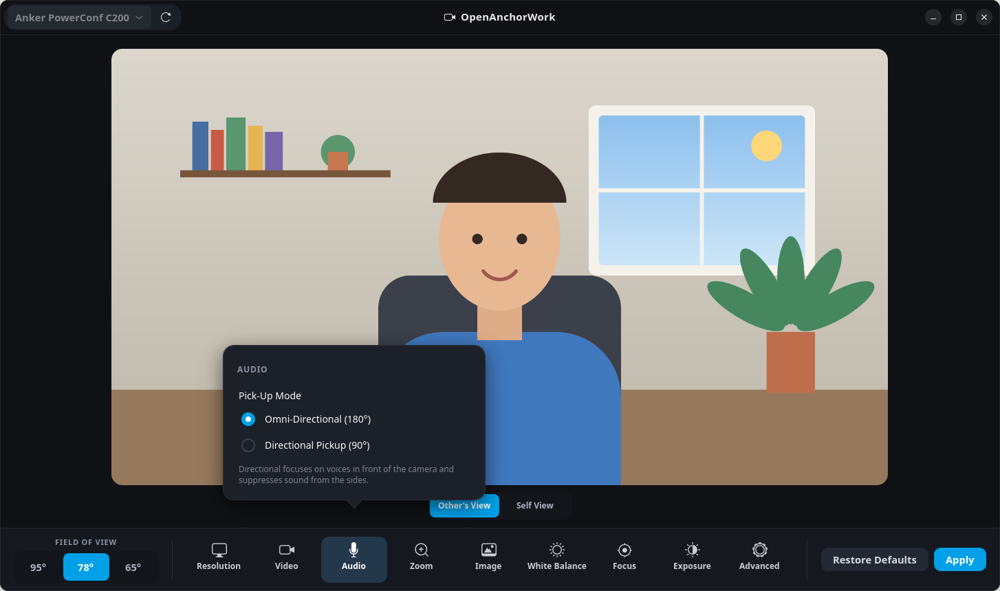
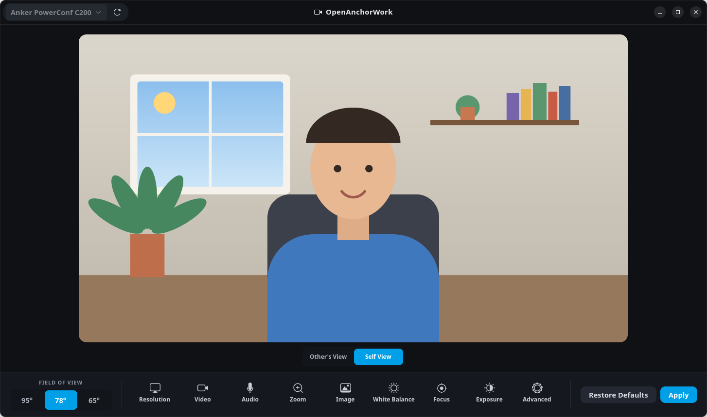

# OpenAnchorWork

An open-source Linux app for Anker webcams. Anker's own app, AnkerWork, only runs on Windows and macOS;
OpenAnchorWork gives Linux users the same camera settings, plus a few the official app doesn't offer.



> OpenAnchorWork is an independent project. It is not affiliated with, endorsed by or supported by Anker
> Innovations. "Anker", "AnkerWork" and "PowerConf" are trademarks of their owners and are used here only to
> say which hardware the app works with. No code from AnkerWork is included.

## Supported cameras

| Camera | USB ID | Status |
|---|---|---|
| Anker PowerConf C200 | `291a:3369` | Supported |

Only the cameras listed here are shown. Other webcams are ignored on purpose. Each model is a profile in
[`profiles.py`](profiles.py); see [Adding a camera](docs/ADDING_A_CAMERA.md) if you'd like to help support
another model.

Not sure which model you have? Run `lsusb | grep -i 291a`.

## Features

| | |
|---|---|
| **Field of view** | 95° / 78° / 65°, the same presets as AnkerWork. Kept when Teams, Meet, Zoom or any other app opens the camera (the C200 normally resets it). |
| **HDR** | Anker's HDR mode, decoded from AnkerWork. |
| **Pick-Up Mode** | Microphone focus: Omni-Directional, or Directional Pickup (90°) for voices in front of the camera. |
| **Mirror / Upside Down** | Flips the picture inside the camera, so every app gets it. Useful for a camera mounted upside down. AnkerWork doesn't offer this for the C200. |
| **Other's View / Self View** | Shows the preview as the other people in a call see it, or mirrored like your self-view. |
| **Image** | Brightness, contrast, saturation, sharpness, gamma, hue. |
| **Exposure, white balance, focus** | Automatic or manual, plus anti-flicker (50/60 Hz). Auto exposure can be switched back on without replugging (see [why](docs/PROTOCOL.md#auto-exposure)). |
| **Zoom, pan, tilt** | Digital zoom with pan and tilt. |
| **Settings that stick** | Re-applied automatically when the camera is plugged in and whenever an app starts it. |

| Video | Audio | Self View |
|---|---|---|
|  |  |  |

Sliders sit in pop-ups, so scrolling over the window never changes a setting by accident.

## Requirements

* Linux desktop with systemd (any recent Ubuntu, Debian, Fedora, Arch, Mint, Pop!_OS…)
* Python 3.10 or newer
* GTK 4.12+, libadwaita 1.5+, GStreamer with the "good" plugins

Install the dependencies:

```sh
# Ubuntu 24.04+ / Debian 13+ / Mint / Pop!_OS
sudo apt install python3-gi gir1.2-gtk-4.0 gir1.2-adw-1 gir1.2-gstreamer-1.0 gstreamer1.0-plugins-good

# Fedora
sudo dnf install python3-gobject gtk4 libadwaita gstreamer1-plugins-good

# Arch
sudo pacman -S python-gobject gtk4 libadwaita gst-plugins-good
```

There are no pip packages to install.

## Install

```sh
git clone https://github.com/amitt00r/OpenAnchorWork.git ~/OpenAnchorWork
cd ~/OpenAnchorWork
./install.sh
```

`install.sh` sets up three things for your user:

1. **A menu entry**, so OpenAnchorWork appears in your app launcher.
2. **A background watcher** (`openanchorwork-watch.service`, a systemd user service) that re-applies your
   settings when the camera is plugged in and every time an app starts using it.
3. **A udev rule** (asks for your password once) that gives your desktop session access to the camera's USB
   device. The app needs it to switch auto exposure back on.

The app runs from the folder you cloned, so keep the folder where it is (or run `./install.sh` again after
moving it).

To try it without installing: `python3 app.py`.

## Using it

* **Close OpenAnchorWork before joining a call.** The preview uses the camera, and most Linux apps can't
  share it. Your settings stay on the camera after you close the window.
* The bottom bar holds the field-of-view buttons and one button per category; each opens a pop-up.
* **Apply** sends all your saved settings to the camera again. **Restore Defaults** resets everything.
* Settings are saved per camera model in `~/.config/openanchorwork/` (for the C200: `anker-c200.json`).

Command line:

```sh
python3 app.py --apply                         # push saved settings to the camera and exit
journalctl --user -u openanchorwork-watch -f   # watch the background service
```

## Troubleshooting

| Problem | Fix |
|---|---|
| "No supported camera connected" | Check `lsusb` lists `291a:3369`, then press the rescan button. |
| "Camera is busy" | Another app is using the camera. The preview comes back by itself once it's free. |
| FOV resets to 95° in other apps | The background watcher isn't running: `systemctl --user status openanchorwork-watch`. Run `./install.sh` again. |
| Auto exposure won't switch back on | The udev rule isn't installed. Run `./install.sh`, or replug the camera. |
| Pick-Up Mode seems to do nothing | It only affects the camera's own microphones. Choose "Anker PowerConf C200" as the microphone in your call app. |

## Uninstall

```sh
./uninstall.sh
```

Your saved settings stay in `~/.config/openanchorwork/`; delete that folder too if you want them gone.

## How it works

OpenAnchorWork talks to the camera through the standard Linux webcam interface (V4L2/UVC). The Anker-specific
features (FOV, HDR, Pick-Up Mode, Mirror/Upside Down) use a vendor extension of the camera, worked out by
studying how AnkerWork talks to it and then verified on real hardware. The details, including the firmware
quirks the app works around, are in [docs/PROTOCOL.md](docs/PROTOCOL.md).

| File | Purpose |
|---|---|
| `app.py` | The GTK4 / libadwaita app |
| `profiles.py` | Supported camera models and what each supports |
| `anker_xu.py` | Anker vendor commands |
| `v4l2ctl.py` | Standard webcam controls, plus the raw USB auto-exposure fix |
| `settings_store.py` | Saving settings and sending them to the camera |
| `watcher.py` | Background service that keeps settings applied |
| `tools/make_screenshots.py` | Regenerates the screenshots (with an illustration, not a real camera image) |

## Contributing

Bug reports and pull requests are welcome. Support for more Anker cameras is the most useful contribution;
start with [docs/ADDING_A_CAMERA.md](docs/ADDING_A_CAMERA.md).

## Related

[erans/anker-powerconf-c200-linux-tools](https://github.com/erans/anker-powerconf-c200-linux-tools) is an
independent command-line tool for the C200 that reached the same vendor command map.

## License

[MIT](LICENSE)
